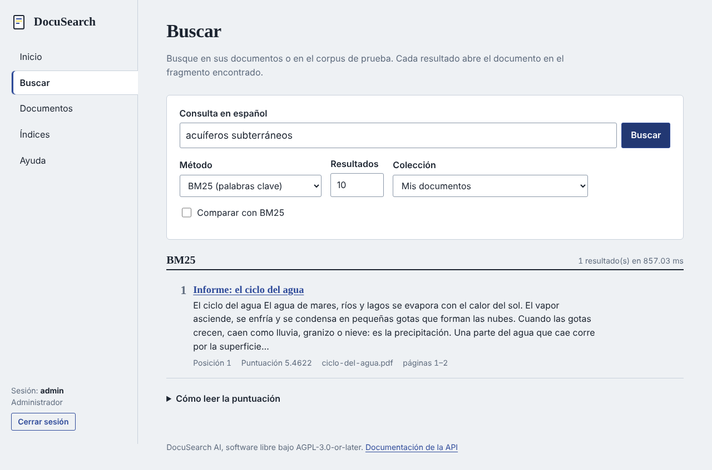

# DocuSearch AI

Buscador de documentos en español. Carga archivos PDF, Word (DOCX) y de texto,
extrae y fragmenta su contenido y lo busca por palabras clave (BM25, TF-IDF)
o por significado (embeddings multilingües con FAISS, y búsqueda híbrida).
Cada resultado lleva al fragmento y la página de origen. Funciona en una
computadora personal, **sin GPU y sin servicios en la nube**.

Proyecto académico (UAEM, 2026-B) · Licencia AGPL-3.0-or-later.

## Estado: v1.0.0

| Funciona | Detalle |
| --- | --- |
| Aplicación web en `http://127.0.0.1:8000/` | Inicio de sesión, documentos, visor, buscador, índices, ayuda; accesible y responsive |
| Carga de documentos | PDF con texto, PDF escaneado (OCR con Tesseract en español), DOCX, TXT, Google Docs **públicos** |
| Búsqueda | BM25 (por defecto), TF-IDF, semántica e híbrida (RRF); top-k = 10; título, fragmento, puntuación, página y origen |
| Administración | Editar título y metadatos, eliminar (también de los índices), reindexar y OCR con estado real |
| Seguridad | Cuentas locales Administrador/Usuario, sesión `HttpOnly`, CSRF, CSP, pruebas adversariales |
| Calidad medida | MIRACL-es (648 consultas con juicios humanos): nDCG@10 híbrida **0,752** frente a BM25 **0,709** (p < 0,0001), en el subconjunto de pasajes juzgados ([informe](docs/informe-academico.md)) |

**No incluido en v1.0:** Google Docs privados (OAuth), respuestas generadas
(RAG) y uso multiusuario. Es un **modo local monousuario**: no debe exponerse
a una red sin HTTPS ([seguridad](docs/seguridad.md)).



## Inicio rápido (Windows)

Requiere Python 3.10–3.12. Guía completa y solución de problemas en
[`docs/instalacion-windows.md`](docs/instalacion-windows.md).

```powershell
powershell -ExecutionPolicy Bypass -File scripts\windows\instalar.ps1           # -Semantico: búsqueda por significado (CPU)
powershell -ExecutionPolicy Bypass -File scripts\windows\configurar-cuenta.ps1  # contraseña del Administrador
.\.venv\Scripts\python.exe -m backend.app.cli demo                              # documentos de demostración
powershell -ExecutionPolicy Bypass -File scripts\windows\iniciar.ps1           # abre http://127.0.0.1:8000/
```

### Linux / macOS o instalación manual

```bash
python -m venv .venv && . .venv/bin/activate
python -m pip install -e ".[model]"            # + ".[semantic]" para semántica e híbrida
cp .env.example .env
python -m backend.app.cli hash-password --env-file .env
python -m backend.app.cli demo
python -m uvicorn backend.app.main:app --host 127.0.0.1 --port 8000
```

`python -m backend.app.cli doctor` revisa la instalación y dice qué falta.

## Uso

- **Web:** [manual de usuario y de administrador](docs/manual.md).
- **API:** http://127.0.0.1:8000/docs y [`docs/api.md`](docs/api.md).
- **Terminal:** `python -m backend.app.cli --help` (`reindex`,
  `semantic-index`, `ocr`, `evaluate`, `benchmark`, `miracl`, `doctor`, `demo`, …).

## Documentación

| Documento | Contenido |
| --- | --- |
| [`docs/manual.md`](docs/manual.md) | Manual de Usuario y Administrador |
| [`docs/informe-academico.md`](docs/informe-academico.md) | Arquitectura, metodología, evaluación, rendimiento, limitaciones |
| [`docs/trazabilidad.md`](docs/trazabilidad.md) | Requisitos RF01–RF08 / RNF01–RNF07 con evidencia, Issues y PR |
| [`docs/guion-demostracion.md`](docs/guion-demostracion.md) | Guion de 8–12 minutos y lista de comprobación |
| [`docs/instalacion-windows.md`](docs/instalacion-windows.md) | Instalación, modos, problemas frecuentes, plataformas verificadas |
| [`docs/seguridad.md`](docs/seguridad.md) / [`docs/autenticacion.md`](docs/autenticacion.md) | Modelo de amenazas, cuentas y sesión |
| [`docs/evaluacion.md`](docs/evaluacion.md) / [`docs/pruebas.md`](docs/pruebas.md) | Evaluación reproducible, pruebas y checks de CI |
| [`docs/arquitectura.md`](docs/arquitectura.md), [`docs/adr/`](docs/adr/) | Diseño y decisiones |
| [`docs/bitacora.md`](docs/bitacora.md), [`CHANGELOG.md`](CHANGELOG.md) | Registro por Issue y cambios por versión |

## Pruebas

```powershell
python -m pip install -e ".[dev,model,e2e]"
python -m pytest -q                                            # suite de Python
python -m playwright install chromium
$env:DOCUSEARCH_TEST_BROWSER = "1"; python -m pytest -q tests/e2e   # navegador real
```

Cada Pull Request ejecuta `tests (3.10/3.11/3.12)`, `web-e2e` (Chromium),
`windows-install` (instalación limpia en Windows), `semantic-model` (modelo
real) y GitGuardian ([detalle](docs/pruebas.md)).

## Módulos

| Ruta | Responsabilidad |
| --- | --- |
| `backend/app/api/` | Endpoints: documentos, búsqueda, sesión, administración |
| `backend/app/auth/` | Contraseñas scrypt, sesiones, roles, CSRF |
| `backend/app/documents/` | Validación, lectores PDF/DOCX/TXT, OCR, almacén, SQLite |
| `backend/app/nlp/` | Preprocesamiento, fragmentación, embeddings |
| `backend/app/search/` | TF-IDF, BM25, FAISS, híbrida, evaluación, mantenimiento de índices |
| `backend/app/jobs.py`, `security.py`, `web.py` | Tareas en segundo plano, cabeceras y filtros, servido de la web |
| `frontend/` | Interfaz web (HTML, CSS, módulos JS sin dependencias) |
| `scripts/windows/` | Instalar, configurar la cuenta, iniciar, verificar |
| `demo/` | Documentos sintéticos y consultas de demostración |
| `evaluation/` | Consultas y resultados de evaluación versionados |
| `tests/` | Pruebas unitarias, de integración, de seguridad y E2E (`tests/e2e/`) |

## Datos y privacidad

Los documentos, la base de datos y los índices se guardan en `data/` (o en
`DOCUSEARCH_DATA_DIR`) y **no se versionan**. No suba documentos personales,
índices, bases de datos ni `.env` al repositorio.

## Licencia

DocuSearch AI se distribuye bajo la **GNU Affero General Public License v3.0
o posterior** (`AGPL-3.0-or-later`); ver [`LICENSE`](LICENSE). Si ofreces el
servicio modificado a otras personas a través de una red, la AGPL te obliga a
poner a su disposición el código fuente de esa versión. Las licencias de
dependencias, modelos y datos de terceros se resumen en
[`THIRD_PARTY_NOTICES.md`](THIRD_PARTY_NOTICES.md) y el motivo de la elección
en `docs/licencias.md`.
