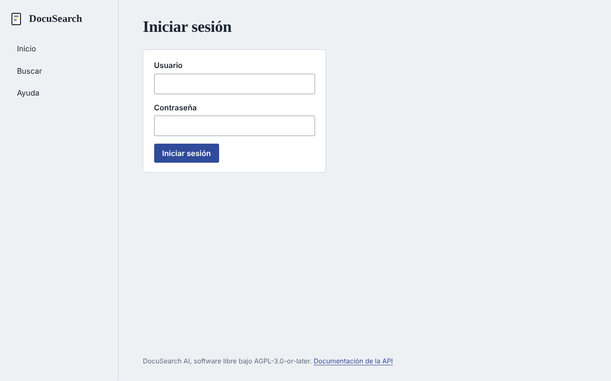
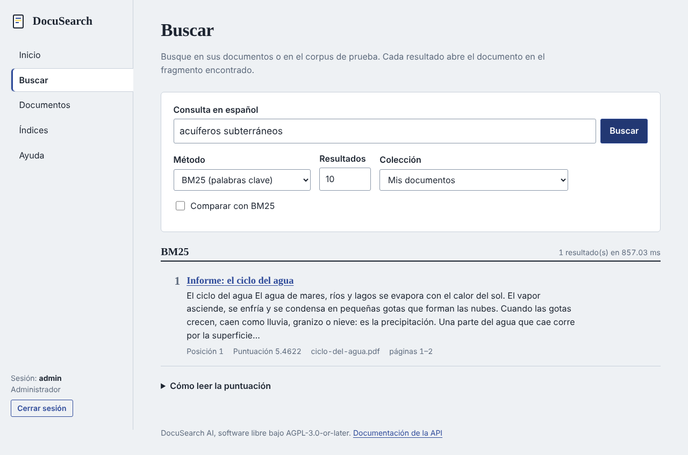
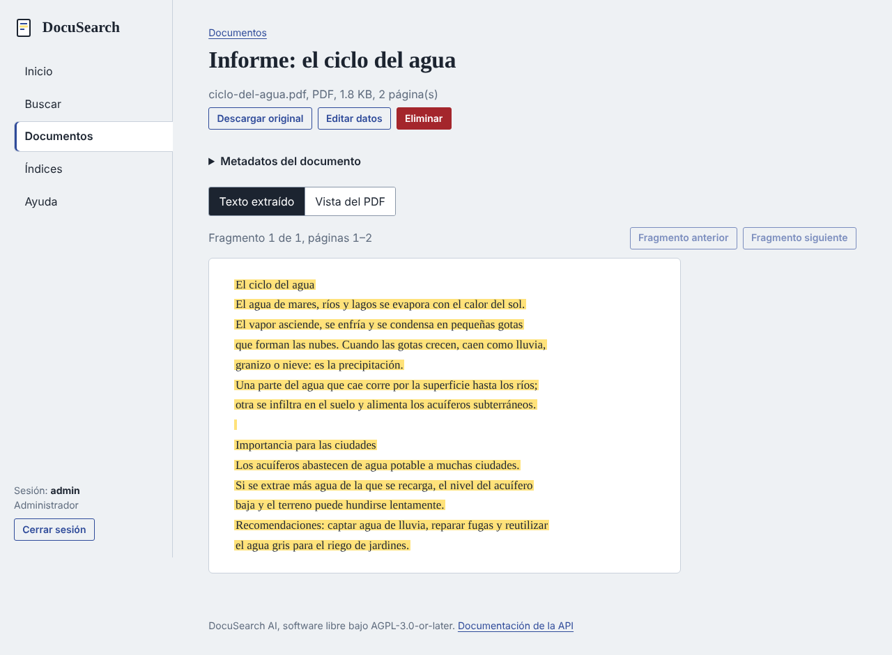
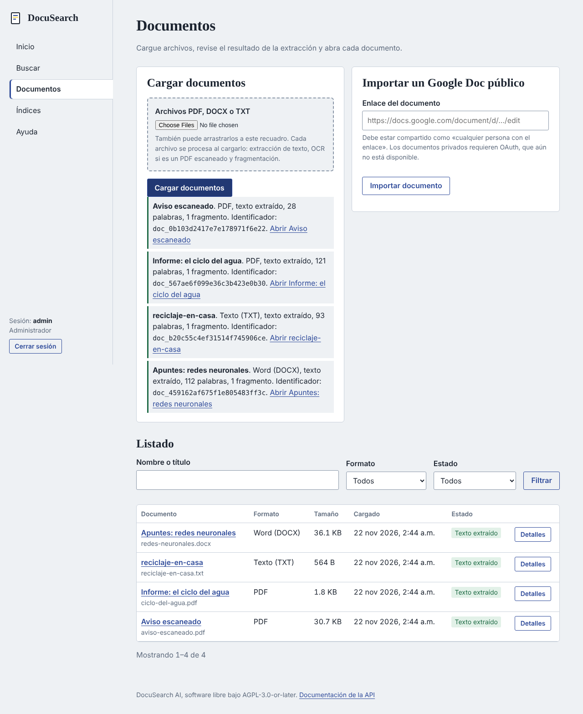
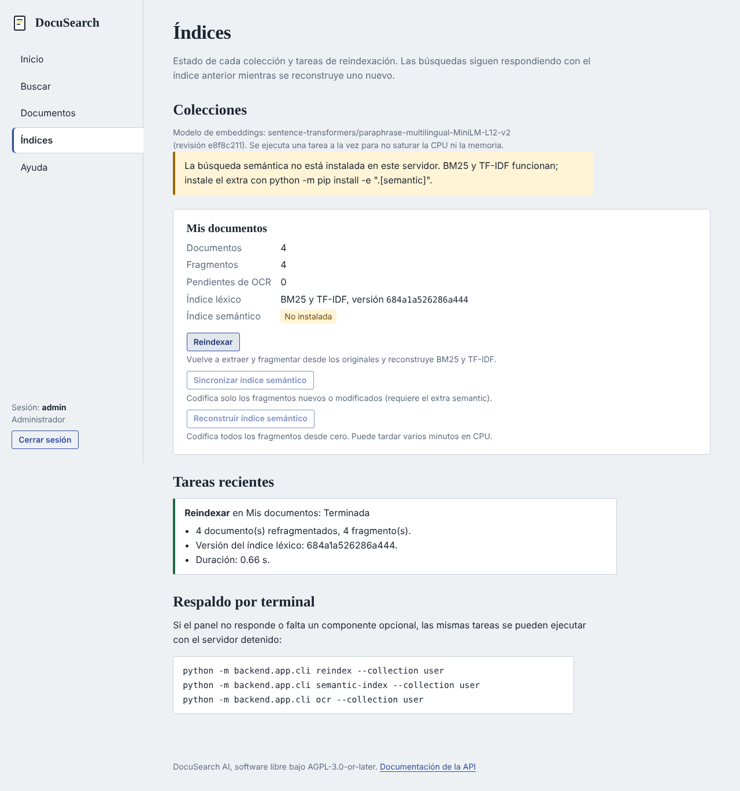

# Manual de usuario y de administrador — DocuSearch v1.0

DocuSearch busca dentro de documentos en español (PDF, Word DOCX y texto)
y lleva cada resultado al fragmento y la página donde aparece. Funciona en
una sola computadora (`http://127.0.0.1:8000/`), sin GPU y sin servicios en
la nube. Instalación: [`instalacion-windows.md`](instalacion-windows.md).

## Roles

| Rol | Qué puede hacer |
| --- | --- |
| Sin sesión | Buscar en el corpus público de prueba (Wikipedia en español) |
| Usuario de consulta | Ver la lista de documentos, abrirlos, descargarlos y buscar en ellos |
| Administrador | Todo lo anterior, más cargar, importar, editar, eliminar y reindexar |

Hay como máximo una cuenta de cada rol; no es un sistema multiusuario.

## Para el Usuario

### Iniciar y cerrar sesión

1. Abra http://127.0.0.1:8000/ y elija **Iniciar sesión**.
2. Escriba el usuario y la contraseña que le dio el Administrador.
3. La sesión se cierra sola tras 30 minutos sin actividad o al reiniciar el
   servidor. **Cerrar sesión** la invalida de inmediato.



### Buscar

1. Entre en **Buscar** y escriba la consulta en español.
2. Elija el **método**:
   - *BM25* (por defecto) y *TF-IDF*: palabras clave; funcionan siempre.
   - *Semántica*: por significado, encuentra paráfrasis sin palabras en común.
   - *Híbrida*: combina BM25 y semántica; es la de mejor calidad medida
     (ver el informe).
   - Las dos últimas requieren el componente opcional `semantic`; si falta,
     la página lo indica y sugiere BM25.
3. **Resultados**: 10 por defecto (de 1 a 100).
4. **Comparar con BM25** muestra los dos rankings lado a lado con la misma consulta.

Cada resultado muestra la posición, el título, el fragmento (con las palabras
de la consulta resaltadas), la puntuación, el archivo y la página. **Las
puntuaciones de métodos distintos no se comparan entre sí**: cada método usa
su escala ("Cómo leer la puntuación" lo explica bajo los resultados).



### Ver el documento de origen

El título de un resultado abre el **visor** con el fragmento encontrado
resaltado y su página. Desde ahí puede:

- recorrer los fragmentos con **Fragmento anterior / siguiente**;
- en un PDF, abrir **Vista del PDF** en la página del fragmento;
- ver los **metadatos** (identificador, huella SHA-256, páginas, procedencia);
- **Descargar original**.



Un PDF escaneado sin OCR se muestra con un aviso: se puede ver y descargar,
pero no aparece en las búsquedas hasta que se reconozca su texto.

## Para el Administrador

### Crear la cuenta

`scripts\windows\configurar-cuenta.ps1` (o `python -m backend.app.cli
hash-password --env-file .env`). No hay contraseña por defecto; en `.env`
solo se guarda el hash. Detalles en [`autenticacion.md`](autenticacion.md).

### Cargar documentos

En **Documentos → Cargar documentos** elija o arrastre archivos `.pdf`,
`.docx` o `.txt` (20 MB por archivo de forma predeterminada). Cada archivo
muestra su resultado real: texto extraído o pendiente de OCR, palabras,
fragmentos, avisos e identificador. Los errores (duplicado, formato no
admitido, archivo dañado, demasiado grande) se explican por archivo y la
selección se conserva para reintentar.

**Importar un Google Doc público** acepta enlaces de documentos compartidos
como "cualquier persona con el enlace". Los documentos privados requieren
OAuth, que no forma parte de esta versión.



### Listado, filtros y detalle

El listado se puede filtrar por nombre, formato y estado. **Detalles**
muestra el identificador, la huella y la configuración de fragmentación.

### Editar y eliminar

En el visor:

- **Editar datos** cambia el título, la descripción y las etiquetas. El
  archivo original, su huella y sus fragmentos no cambian.
- **Eliminar** pide confirmación, porque no se puede deshacer. Borra el
  original, los metadatos, los fragmentos y sus datos en los índices de
  búsqueda; el documento deja de aparecer en todas las búsquedas.

### Índices y reindexación

**Índices** muestra, por colección, documentos, fragmentos, pendientes de OCR
y versión de los índices léxico y semántico. Las tareas:

| Tarea | Cuándo usarla |
| --- | --- |
| Reindexar | Tras cambiar `DOCUSEARCH_CHUNK_SIZE`/`DOCUSEARCH_CHUNK_OVERLAP` o si se sospecha un índice inconsistente |
| Sincronizar índice semántico | Para preparar la búsqueda semántica tras cargar documentos (si no, se hace en la primera búsqueda) |
| Reconstruir índice semántico | Tras cambiar de modelo o si el índice está dañado |
| Reconocer PDF escaneados | Tras instalar Tesseract con español |

Se ejecuta una tarea a la vez. El avance se muestra solo cuando hay una
cifra real; si no, la barra queda indeterminada. Mientras tanto, las
búsquedas siguen respondiendo.



### Respaldo por terminal

```powershell
python -m backend.app.cli doctor                         # diagnóstico
python -m backend.app.cli reindex --collection user      # reindexar
python -m backend.app.cli semantic-index --collection user
python -m backend.app.cli ocr --collection user
python -m backend.app.cli demo                           # documentos de demostración
```

## Privacidad

Los documentos, la base de datos y los índices se guardan en `data/` (o en
`DOCUSEARCH_DATA_DIR`) y nunca se suben al repositorio. Nada se envía a
servicios externos, salvo dos casos: la descarga de un Google Doc público
cuando usted lo importa y la primera descarga del modelo de embeddings.
